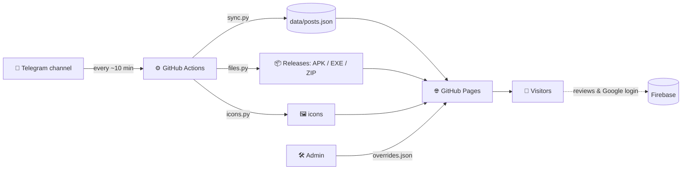

<div align="center">

# 🕌 Telegram App Store · متجر تطبيقات من قناة تيليجرام

**حوّل قناتك العامة على تيليجرام إلى متجر تطبيقات حديث يعمل تلقائياً، مجاناً، على GitHub Pages.**
*Turn a public Telegram channel into a modern, auto-updating app store. Free. Serverless.*


[🌐 الموقع / Live](https://USERNAME.github.io/REPO/) · [🛠 الأدمن / Admin](https://USERNAME.github.io/REPO/admin.html)

</div>



<div dir="rtl">

## ✨ المميزات

- 🔄 **تحديث تلقائي بالكامل:** أي منشور جديد في القناة يظهر في المتجر بدون تدخل منك. والمنشورات القديمة تُسحب أيضاً.
- 🗂 **تصنيف ذكي:** تطبيقات، سطح المكتب، إضافات، ملفات ووسائط، وأخبار، كلها من محتوى المنشور نفسه.
- ⬇️ **تحميل مباشر** للملفات حتى 2 جيجا عبر GitHub Releases (اختياري).
- 🖼 **استخراج الأيقونة تلقائياً** من ملفات APK وEXE وإضافات المتصفح (اختياري).
- ⭐ **تقييمات ومراجعات** وتسجيل دخول بجوجل عبر Firebase (اختياري).
- 🛠 **لوحة أدمن:** تعديل أي منشور، إخفاؤه، تغيير تصنيفه، أو إضافة تطبيق يدوياً.
- 🌙 **تصميم إسلامي عصري** متجاوب مع الوضع الليلي، وأنيميشن، ولقطات شاشة، وتشغيل فيديو.
- 🔐 **آمن للمستودع العام:** لا توجد أسرار في الكود، كل الأسرار في GitHub Secrets.
- 💸 **مجاني 100%:** GitHub Pages وActions وReleases وFirebase (الباقة المجانية).

## 🧠 كيف يعمل؟

| الخطوة | الملف | ماذا يفعل |
|---|---|---|
| 1 | `scripts/sync.py` | يقرأ صفحة القناة العامة `t.me/s/القناة` (بدون أي توكن)، يدمج الصور والملف مع نص المنشور، ويحفظ `data/posts.json` |
| 2 | `scripts/files.py` | يحمّل الملفات من تيليجرام ويرفعها على Releases، ويضيف رابط التحميل المباشر |
| 3 | `scripts/icons.py` | يستخرج الأيقونة من الملف ويحفظها في `media/` |
| 4 | `index.html` | يعرض المتجر للزوار من `posts.json` |
| 5 | `admin.html` | يكتب تعديلاتك في `data/overrides.json` عبر GitHub API |

## 🚀 البدء السريع (10 دقائق)

> **المتطلب:** قناة تيليجرام **عامة** (لها رابط `t.me/اسم_القناة`).

1. اعمل **Fork** أو ارفع الملفات إلى مستودع **Public** جديد.
2. غيّر اسم القناة `muslim_appss` إلى قناتك في `.github/workflows/sync.yml` (في كل مكان يظهر فيه `CHANNEL`).
3. من **Settings ثم Actions ثم General** اختر **Read and write permissions**.
4. من **Settings ثم Pages** اختر Branch: `main` وFolder: `/ (root)`.
5. من تبويب **Actions** شغّل **sync-telegram** بزر **Run workflow**.
6. افتح `https://USERNAME.github.io/REPO/`. 🎉

من هنا يتحدث الموقع تلقائياً. الخطوات التالية كلها **اختيارية**.

## 🏷 كيف يُصنَّف المنشور؟

| محتوى المنشور | التبويب |
|---|---|
| ملف `.apk` | 📱 التطبيقات |
| ملف `.exe` | 🖥 سطح المكتب |
| ملف + هاشتاج `#اضافه` أو `#اضافات` | 🧩 الإضافات |
| أي ملف آخر، فيديو، أو صورة | 🎞 الملفات والوسائط |
| نص فقط | 📰 آخر الأخبار |

**نصيحة:** اكتب اسم التطبيق في **أول سطر** من النص، فهو العنوان. والباقي وصف. اكتب `الإصدار 1.2` لتظهر نسخة التطبيق.
منشور فيه ملف **بدون أي نص** لا يظهر، لأن العنوان يؤخذ من النص.

## ⚙️ الإضافات الاختيارية

<details>
<summary><b>⬇️ التحميل المباشر (Telethon + Releases)</b></summary>

تيليجرام لا يتيح ملفات الصفحة العامة، لذلك نستخدم حساب مستخدم لتحميلها ثم رفعها على Releases.

1. من [my.telegram.org](https://my.telegram.org) ادخل **API development tools** وخذ `api_id` و`api_hash`.
2. على جهازك: `pip install telethon` ثم `python scripts/make_session.py`. أدخل رقمك بالصيغة الدولية `+201012345678` والكود.
3. أضف 3 أسرار من **Settings ثم Secrets and variables ثم Actions**:

| السر | القيمة |
|---|---|
| `TG_API_ID` | الرقم من my.telegram.org |
| `TG_API_HASH` | النص من my.telegram.org |
| `TG_SESSION` | النص الطويل الذي طبعه `make_session.py` |

> ⚠️ `TG_SESSION` يعطي دخولاً كاملاً على الحساب. استخدم **حساباً ثانوياً**، ولا تضعه في أي ملف.

كل تشغيل يعالج 15 ملفاً. الحد 2 جيجا للملف الواحد.
</details>

<details>
<summary><b>🛠 لوحة الأدمن</b></summary>

1. أنشئ **Fine-grained token** (Settings ثم Developer settings) لهذا المستودع فقط، بصلاحية **Contents: Read and write**.
2. افتح `/admin.html`، أدخل `username/repo` والتوكن.
3. عدّل ما تريد واضغط **حفظ ونشر**. التوكن يبقى في متصفحك فقط.

تعديلاتك تُحفظ في `data/overrides.json` وتغلب على التصنيف التلقائي دائماً.
</details>

<details>
<summary><b>⭐ التقييمات وتسجيل الدخول (Firebase)</b></summary>

1. أنشئ مشروعاً في [Firebase Console](https://console.firebase.google.com) وفعّل **Authentication ثم Google**.
2. أضف نطاقك `USERNAME.github.io` في **Authorized domains**.
3. فعّل **Firestore** والصق محتوى `firestore.rules` في تبويب Rules ثم **Publish**.
4. أضف **Web App** وضع قيمه في `firebase-config.js`:

```js
export const CFG = {
  apiKey: "...", authDomain: "...", projectId: "...", appId: "..."
};
```

مفاتيح الويب في Firebase عامة بطبيعتها، والحماية الفعلية من `firestore.rules`.
اسم المجموعة الافتراضي `reviews`. لو مشروعك يستخدمه لتطبيق آخر فاستبدله بـ`store_reviews` في **`index.html` والقواعد معاً**.
</details>

## 🗂 هيكل المشروع

```
├── index.html              # واجهة المتجر
├── admin.html              # لوحة الأدمن
├── firebase-config.js      # إعدادات Firebase (عامة)
├── firestore.rules         # قواعد حماية التقييمات
├── data/
│   ├── posts.json          # يُولَّد تلقائياً من القناة
│   └── overrides.json      # تعديلات الأدمن
├── media/                  # صور المنشورات والأيقونات
├── scripts/
│   ├── sync.py             # قراءة القناة وتصنيف المنشورات
│   ├── files.py            # رفع الملفات على Releases
│   ├── icons.py            # استخراج الأيقونات
│   └── make_session.py     # توليد TG_SESSION (يُشغَّل مرة على جهازك)
└── .github/workflows/sync.yml
```

## 🔐 الأمان

- لا توجد توكنات في الكود. الأسرار في **GitHub Secrets** فقط.
- توكن الأدمن يُحفظ في متصفحك ولا يُرفع.
- لا ترفع أبداً: `TG_SESSION` أو `TG_API_HASH` أو ملف Service Account.
- ملفات Releases **عامة**. ارفع فقط ما لك حق نشره.
- تأكد أن قواعد Firestore لا تحتوي `allow write: if true` على بيانات حساسة.

## ❓ أسئلة شائعة وحل المشاكل

| المشكلة | الحل |
|---|---|
| الصفحة 404 بعد التفعيل | انتظر 2 إلى 5 دقائق، وتأكد من إعداد Pages |
| لا يظهر شيء من القناة | القناة يجب أن تكون عامة، وراجع سجل **Actions** |
| فشل الدفع `Permission denied` | فعّل **Read and write permissions** في إعدادات Actions |
| المزامنة كل ساعة وليس 10 دقائق | هذا تأخير جدولة GitHub المجاني، ويمكن التشغيل يدوياً |
| منشور قديم تغيّر تصنيفه | شغّل **Run workflow** مع تفعيل `refresh` |
| تعديل منشور على تيليجرام لا يظهر | عدّله من لوحة الأدمن، أو انشر منشوراً جديداً |
| `auth/unauthorized-domain` | أضف `USERNAME.github.io` في Authorized domains |
| زر تسجيل الدخول لا يظهر | راجع `firebase-config.js` |
| لا أيقونة لتطبيق | بعض ملفات APK الحديثة تخفي الأيقونة، وتظهر أول صورة بدلاً منها |

## 🤝 المساهمة

الأفكار والتحسينات مرحّب بها عبر **Issues** و**Pull Requests**. أفكار مقترحة: دعم `.xapk`، البحث المتقدم، تعدد اللغات، إشعارات بالتحديثات.

## 📄 الترخيص

MIT. استخدمه وعدّله بحرية، ولا يوجد أي ضمان.
**⚠️ مسؤوليتك** أن يكون ما تنشره في متجرك مسموحاً بنشره، وموافقاً لشروط تيليجرام وGitHub.

</div>

---

## 🇬🇧 English summary

**What it is:** a serverless app store generated from a *public* Telegram channel. GitHub Actions scrapes `t.me/s/<channel>` every ~10 minutes, classifies posts, and GitHub Pages serves a modern Arabic/RTL storefront.

**Classification:** `.apk` → Apps · `.exe` → Desktop · file + `#اضافه`/`#اضافات` → Add-ons · other files/video/photos → Media · text-only → News.

**Quick start**
1. Put the files in a new **public** repo.
2. Replace `muslim_appss` with your channel in `.github/workflows/sync.yml`.
3. *Settings → Actions → General* → **Read and write permissions**.
4. *Settings → Pages* → branch `main`, folder `/ (root)`.
5. *Actions → sync-telegram → Run workflow*.

**Optional**
- **Direct downloads (up to 2 GB):** Telethon user session in GitHub Secrets (`TG_API_ID`, `TG_API_HASH`, `TG_SESSION`) → files uploaded to Releases. Use a throwaway Telegram account.
- **Icons:** extracted from APK / EXE / extension archives into `media/`.
- **Admin panel:** `admin.html` with a fine-grained GitHub token (Contents: write); edits live in `data/overrides.json`.
- **Reviews & Google sign-in:** Firebase (free tier) + `firestore.rules`.

**Security:** no secrets in the repo; Release files are public; only publish what you have the right to distribute.

**License:** MIT.

<div align="center">

**اللهم انفع بهذا العمل · Made with ❤️ for the Muslim community**

</div>
